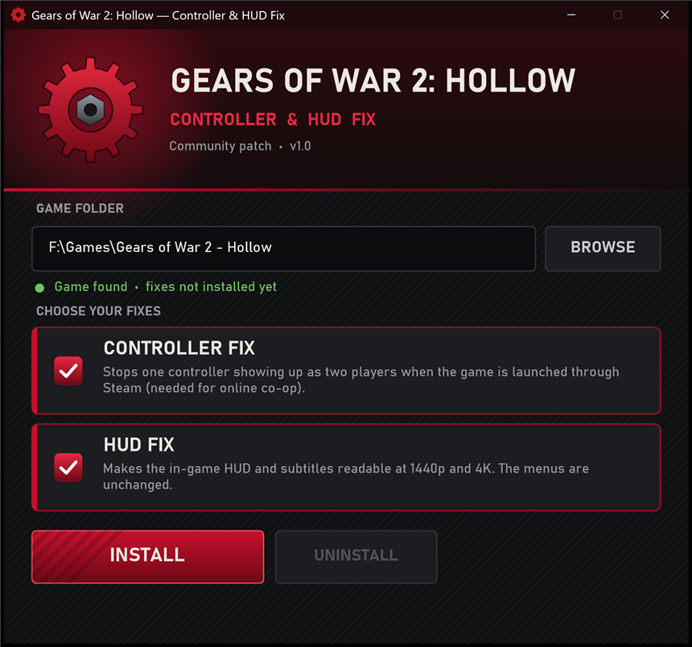
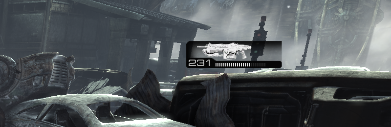
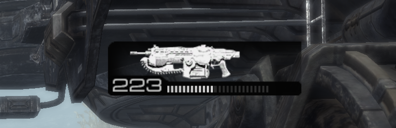
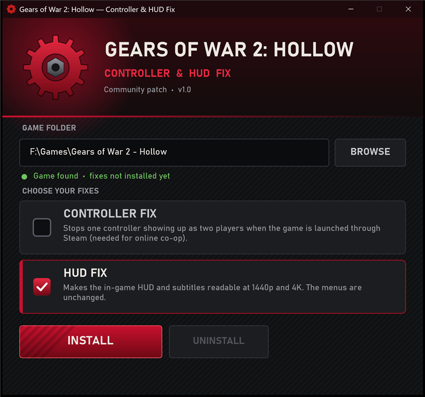
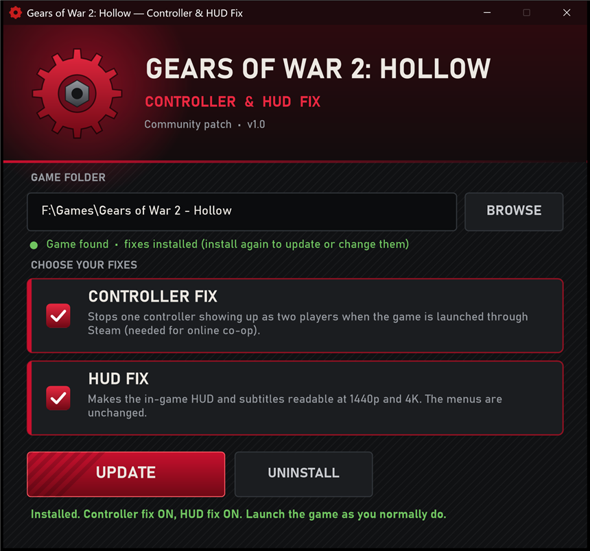

<div align="center">

# Gears of War 2: Hollow Fix

**Controller & HUD fix for the Gears of War 2: Hollow PC port**

[](https://github.com/TekRantGaming/Gears-of-War-2-Hollow-Fix/releases/latest)




</div>

Two separate fixes for the Gears of War 2: Hollow PC port. Install **either one or both**.

## Controller fix

Online co-op only works when Hollow runs through Steam (added as a non-Steam game). The problem: through Steam, one controller often shows up as **two**, so you're signed in twice on the main menu and a second player gets created. Changing Steam Input settings doesn't help, and playing outside Steam breaks multiplayer.

With this fix the game sees exactly **one** controller.

- Works when launched through Steam, from the Hollow launcher's **Play on Steam** button or straight from your Steam library
- Steam Input, the Steam overlay and online co-op keep working
- Also hides the extra "phantom" devices some pads expose (e.g. Razer Wolverine V3 Pro)
- Keyboard and mouse aren't affected

## HUD fix

The in-game HUD (weapon and ammo, crosshair, prompts) and subtitles were made for 720p and never scale, so at 1440p and 4K they're tiny. This fix scales them to your resolution: **2× at 1440p, 3× at 4K**, adjustable. The menus already scale on their own and aren't changed.

| Before (1440p) | After (1440p) |
| :---: | :---: |
|  |  |

---

## Download

Grab the latest version from the **[Releases page](https://github.com/TekRantGaming/Gears-of-War-2-Hollow-Fix/releases/latest)**:

| File | What it is |
| --- | --- |
| **HollowFixInstaller.exe** | The installer. Easiest option, one file, nothing to extract. |
| **HollowFix_v1.0_Manual.zip** | No exe: ready-to-copy folders for a manual install, plus the source code. |

## Requirements

- Gears of War 2: Hollow
- Windows 10 or 11
- Nothing else. No Visual C++ redistributables, .NET or other frameworks.

## Installation

### Option 1: Installer (easiest)

1. Download **HollowFixInstaller.exe** and run it.
2. It finds your game automatically. If it doesn't, click **BROWSE** and pick your Gears of War 2 - Hollow folder (the one with `GoW2Hollow_Launcher.exe` in it).
3. Tick the fixes you want, then click **INSTALL**.
4. Play the game as you normally do.

<table><tr>
<td><br><sub>Pick just the fixes you want</sub></td>
<td><br><sub>Installed. Run it again to change or uninstall.</sub></td>
</tr></table>

> [!NOTE]
> If Windows SmartScreen says *"Windows protected your PC"*, click **More info → Run anyway**. This happens because the installer isn't code-signed, which is normal for community mods. If you'd rather not run an exe, use Option 2.

### Option 2: Manual install (no exe)

1. Download **HollowFix_v1.0_Manual.zip** and extract it.
2. Open your Gears of War 2 - Hollow folder, then its **Binaries** folder (the one with `GoW2Hollow.exe` in it).
3. Pick **one** of these folders and copy everything inside it into Binaries:
   - `1 - Both Fixes`
   - `2 - Controller Fix Only`
   - `3 - HUD Fix Only`
4. Play the game as you normally do.

## Uninstall

- **Installer:** run it again and click **UNINSTALL**. If it backed up another mod's files during install, it puts them back.
- **Manual:** delete `xinput1_3.dll`, `dinput8.dll`, `HollowInputFix.ini` and `HollowInputFix.log` from the Binaries folder.

None of the game's own files are changed.

## Settings

Open `Binaries\HollowInputFix.ini` in Notepad. Each setting has a comment explaining it.

- `ControllerFix=1 / 0` and `HUDFix=1 / 0` turn each fix on or off. If you turn the controller fix on here, `dinput8.dll` also needs to be in Binaries; the installer handles this for you.
- **HUD too big?** Set `ReferenceHeight=1080` for a smaller HUD, or pick a fixed size such as `Scale=1.5`.

---

## Compatibility & known issues

- **Local split-screen:** the controller fix only allows one controller, so turn it off (`ControllerFix=0`) if you play split-screen on one PC. Online co-op isn't affected.
- **Hollow updates:** the fixes were made for the current Hollow build. If Hollow updates its game exe, the fixes check the game before changing anything and switch themselves off where it doesn't match. The game still runs normally, but the fixes may stop working until this mod is updated.
- **HUD sharpness:** the HUD art is scaled up from 720p, so it looks a little soft at 3× (4K). That's the original art resolution, not a bug.
- **Other mods:** mods that also use `xinput1_3.dll` or `dinput8.dll` in the Binaries folder will conflict. The installer backs those files up and restores them when you uninstall.

## Troubleshooting

The game writes `Binaries\HollowInputFix.log` every time it starts. It shows which fixes turned on and which controllers were found. If you report a bug, please [open an issue](https://github.com/TekRantGaming/Gears-of-War-2-Hollow-Fix/issues) and attach it.

<details>
<summary><b>How it works (for the curious)</b></summary>

<br>

The mod is two small proxy DLLs (`xinput1_3.dll` and `dinput8.dll`) that the game loads from its own folder. They pass everything through to the real Windows DLLs, except that:

- **Controller:** reads are filtered so the game sees one pad. Steam's overlay intercepts XInput, so the game's own XInput calls go straight to the fix and Steam's duplicate pad gets filtered out. DirectInput duplicates are hidden from the engine's joystick scan.
- **HUD:** the HUD and subtitle canvases are laid out at 720p and scaled up on the GPU.

</details>

## Building from source

Needs Visual Studio 2022 Build Tools (C++ workload).

```powershell
.\installer\package.ps1
```

This builds both DLLs (`src\`) and the installer (`installer\`), then writes the release files to `dist\`.

The installer can also be scripted:

```
HollowFixInstaller.exe /install [/controller] [/hud] [/path "<game folder>"] [/force]
HollowFixInstaller.exe /uninstall [/path "<game folder>"]
```

## Credits

- The Hollow team, for the PC port
- Hollow Fix by [TekRantGaming](https://github.com/TekRantGaming)
